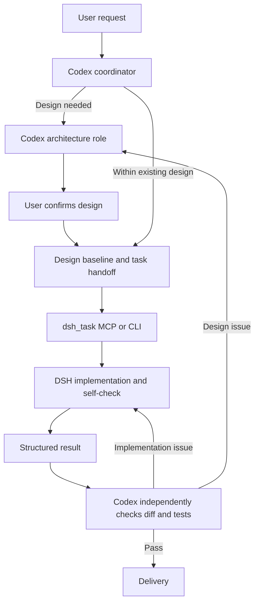

# dsh-codex-bridge

[简体中文](README.md) | **English**

**A bridge plugin built specifically for collaborative software development between DeepSeek Harness (DSH) and Codex.**

Codex delegates a self-contained task to a local DSH agent through MCP or the CLI, receives a structured report, and checks the actual result. DSH keeps its own tools, model configuration, and conversation history. The plugin adds a development workflow without replacing either harness.

Copyright: **残梦**. Development attribution: **led by DeepSeek V4.1 Flash, assisted by GPT 6.1 sol**, as provided by the maintainer. This is an independent integration, not an official DeepSeek or OpenAI release or endorsement.

## Documentation

| Topic | 中文 | English |
| --- | --- | --- |
| Overview | [README](README.md) | This page |
| Installation and use | [使用说明](docs/USAGE.md) | [Usage guide](docs/USAGE.en.md) |
| Roles and model configuration | [角色说明](docs/ROLES.md) | [Roles guide](docs/ROLES.en.md) |
| Skills and workflow | [技能说明](docs/SKILLS.md) | [Skills guide](docs/SKILLS.en.md) |
| Architecture and boundaries | [架构说明](docs/ARCHITECTURE.md) | [Architecture](docs/ARCHITECTURE.en.md) |
| Distribution | [打包说明](PACKAGE-NOTES.md) | [Package notes](PACKAGE-NOTES.en.md) |
| Release notes | [变更记录](CHANGELOG.md) | [Changelog](CHANGELOG.en.md) |

Public documentation and key source comments are bilingual. The existing operational Skill instructions, task-document headings, CLI messages, and DSH report contract remain primarily Chinese. This release does not add a runtime language switch or translate machine-checked field names.

## Components

| Component | Responsibility |
| --- | --- |
| `multi-agent-development` Skill | Task classification, optional architecture design, handoffs, verification, and escalation |
| `dsh-bridge` Skill | How to invoke DSH and interpret its report and execution state |
| MCP server / CLI | Input validation, execution, sessions, cancellation, report checks, and trace metadata |
| Role and document templates | Configure the architecture role and preserve project decisions and task handoffs |



The four roles do not require four simultaneous model instances. The coordinator normally also performs the review. Simple edits can stay with the coordinator; architecture is invoked only when needed. This is a DSH-specific integration, not a general-purpose multi-agent SDK.

## Requirements

- Node.js **22 or later**. Persistent sessions use the global `WebSocket` API.
- A working installation of [DeepSeek Harness](https://github.com/deepseek-ai/deepseek-harness).
- A configured Codex installation with access to the models you select. Run Codex once so its configuration exists.
- Model access and credentials configured for your own environment. No provider key is bundled.

The bridge declares no external npm runtime dependencies. Codex and DSH have their own dependencies and access requirements. The current local verification was performed on macOS with Node 22.14.0. The shell launcher targets POSIX environments; Windows users can use `node dsh-task.mjs`, but Windows DSH execution and sandbox behavior have not been verified in this release.

## Install

From an extracted or cloned bridge directory:

```sh
# Review the proposed Codex changes first.
node install-codex.mjs --dry-run

# Install the roles, two Skills, and managed AGENTS.md block.
node install-codex.mjs
node install-codex.mjs --check

# Optionally expose DSH as an MCP tool in Codex.
node apply-config.mjs
node apply-config.mjs --check
```

The installers maintain only their managed configuration and create backups. `--check` is read-only and returns nonzero for missing, stale, or invalid required configuration. User-disabled MCP configuration is reported without automatically enabling it.

If DSH is not discovered automatically, configure an absolute entry path in the installation terminal:

```sh
export DSH_BIN="/absolute/path/to/@deepseek-ai/dsh/lib/bin.js"
# Alternatively: export DSH_CLI_ROOT="/absolute/path/to/dsh-installation"
node apply-config.mjs
```

Discovery checks explicit configuration, `dsh` on `PATH`, and common Node package locations. `DSH_NODE` selects an explicit Node executable; otherwise the current Node process and `PATH` are used. Missing entries produce configuration guidance rather than a model call.

The MCP configuration persists the required non-secret DSH paths, so a desktop launch does not have to inherit the installation shell's environment. It does not automatically copy `DEEPSEEK_API_KEY` into the configuration. Keep credentials in your intended runtime environment or supported local credential store.

The default Codex home is `$CODEX_HOME` or `~/.codex`. Use `--codex-home /absolute/path` to select another home. For MCP, `--config /absolute/path/config.toml` selects a specific file. Use `CODEX_BIN` or `--codex-bin` when Codex is not on `PATH`.

Restart Codex or open a new session after installation. See the [full guide](docs/USAGE.en.md) for project setup and troubleshooting.

## Delegate a task

```sh
# One-shot analysis; analyze is the default mode.
./dsh-run -C "/absolute/path/to/project" \
  -f src/a.ts -f src/b.ts \
  -g "Identify unhandled failure paths without changing files" \
  -a "Give file locations and reproducible evidence" --json

# Continue the same phase in a named DSH session.
./dsh-run -s project-review -C "/absolute/path/to/project" \
  -g "Summarize the module boundaries"

# Use edit only after the user has authorized implementation.
node dsh-task.mjs -m edit -C "/absolute/path/to/project" \
  -g "Implement the approved export behavior and run its tests" \
  -a "Report the changed files and actual test results" --json
```

`dsh-run` locates the sibling `dsh-task.mjs`, including after the directory is moved. Each `-f` supplies one path; commas inside paths are preserved. The MCP tool accepts `goal`, `cwd`, `files`, `mode`, `context`, `constraints`, `acceptance`, `session`, and `timeout_s`.

Omit `session` for a fresh one-shot task. Reuse a label for related tasks in the same directory and phase. Labels are bound to the canonical working directory. Changing a label does not isolate a shared working tree or resolve an older task that may still be running.

## Interpret the result

DSH returns seven sections: task status, summary, deliverables, findings, verification, unresolved items, and next actions. The operational headings are Chinese; their meanings are explained in the [Skills guide](docs/SKILLS.en.md).

| Field | Meaning |
| --- | --- |
| `execution` | Whether execution completed, failed, timed out, was cancelled, or became unknown |
| `result` | The business outcome claimed by the report: success, partial, failed, or unknown |
| `contractOk` | Required sections are present and no recognized truncation flag invalidates the report |
| `warnings` | Missing sections, weak evidence, truncation, or execution concerns |
| `taskId` / `sessionId` | Trace and session correlation |

Check the fields together. A completed process or structurally complete report does not prove the task succeeded. The coordinator must inspect the diff and verify the acceptance conditions independently.

For `execution_unknown`, do not stack another edit on the same uncertain session. Confirm the old task has stopped before recovery. A process-local dirty-session guard helps prevent reuse, but is not a persistent, cross-process lock.

## Permissions and stored data

| Layer | `analyze` | `edit` |
| --- | --- | --- |
| Authorized business writes | None | The authorized project scope |
| DSH filesystem policy used by the bridge | Read-only | Workspace-write, including system temporary locations |
| Network | Not disabled by the filesystem policy | Not disabled by the filesystem policy |

The DSH sandbox enforces the filesystem policy on supported versions and platforms. The bridge itself still creates runtime homes, session records, and trace metadata. Read-only task execution is not a claim of zero filesystem activity by the entire integration, zero network access, or zero external side effects.

Strict cwd-only isolation is not provided. The architecture role's read-only instruction is also not an independently enforced role-specific sandbox.

Runtime data defaults to `~/.dsh-codex-bridge/`. Traces include a goal prefix of up to 200 characters, its digest, paths, and execution metadata; they do not contain the complete final report, but may still be sensitive. DSH stores its own conversation history separately. Neither belongs in a public source repository.

## Upgrade, move, or uninstall

```sh
# From the new bridge directory after an upgrade or move:
node install-codex.mjs
node apply-config.mjs

# Remove the MCP registration and installed roles / Skills / rules.
node apply-config.mjs --uninstall
node install-codex.mjs --uninstall
```

The installation record tracks managed content and restoration information. Uninstall restores replaced user content where possible. Missing or changed backups, missing records, and user edits are preserved and reported as conflicts; do not delete the records to force removal. DSH credentials, sessions, and unrelated Codex configuration are not uninstall targets.

To retain an existing DSH model configuration or session store during migration, explicitly set `DSH_BRIDGE_HOME` and `DSH_HOST_ROOT` to the previous locations before registration. The installer does not move or delete old DSH runtime data.

## Configuration reference

| Variable | Default or purpose |
| --- | --- |
| `DSH_BIN` / `DSH_CLI_ROOT` | Explicit DSH entry or installation root; otherwise discovery |
| `DSH_NODE` | Node executable override |
| `DSH_BRIDGE_STATE_DIR` | `~/.dsh-codex-bridge` |
| `DSH_BRIDGE_HOME` | `<state-dir>/dsh-home`; the one-shot DSH home |
| `DSH_HOST_ROOT` | `<state-dir>/host`; persistent host state |
| `DSH_TRACE_DIR` | `<host-root>/trace` |
| `DSH_DEFAULT_CWD` | User home when no task directory is supplied; explicitly pass `cwd` for project work |
| `DSH_HOST_PORT_ANALYZE` / `DSH_HOST_PORT_EDIT` | `43191` / `43192` |
| `DSH_TASK_TIMEOUT_S` / `DSH_MAX_OUTPUT` | `600` seconds / `24000` characters |
| `DEEPSEEK_API_KEY` | Runtime credentials; not automatically written into generated configuration |

## Tests and limits

```sh
npm test
# Optional real-DSH suite; review it first. It uses model access and test writes.
npm run test:integration
```

The offline suite covers input/report handling, sessions, traces, installation, relocation, TOML handling, and uninstall protection. It uses temporary Codex homes and DSH fixtures. The real DSH suite is separate and consumes model access; an offline pass does not establish end-to-end model quality or platform sandbox guarantees.

Current boundaries:

- The MCP entry point globally queues calls. Backend session lanes do not mean concurrent execution through that MCP server.
- Session history restoration is not a transactional workflow checkpoint. Dirty state and lanes are process-local.
- One-shot output capture is bounded; the persistent-session output and model-truncation path do not provide identical limits.
- Report checks are heuristic. Task-document checks validate structure and allowed state values, not whether tests actually ran.
- Unsupported complex target TOML representations, such as inline `env`, are rejected rather than rewritten speculatively.
- Operational Skill prompts and machine-checked report headings remain Chinese.

Model usage follows your Codex and DSH configuration. Smaller handoffs and on-demand design can reduce some coordinator context, but no universal cost or performance advantage has been benchmarked.

## License

[MIT License](LICENSE), `Copyright (c) 2026 残梦`.
